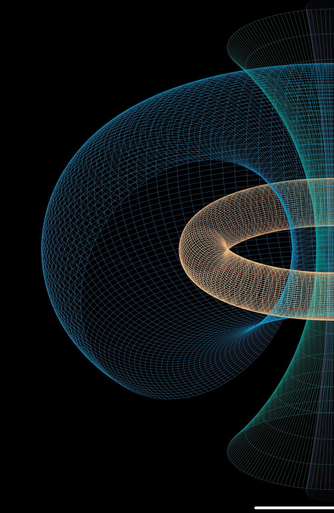
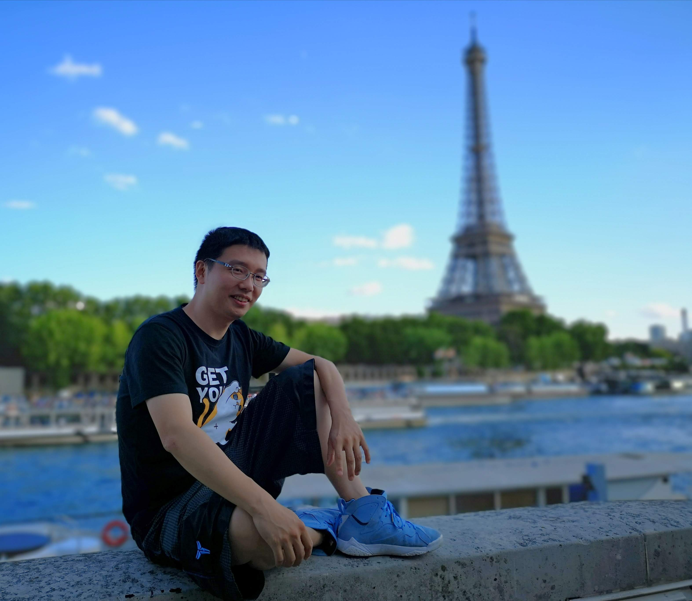
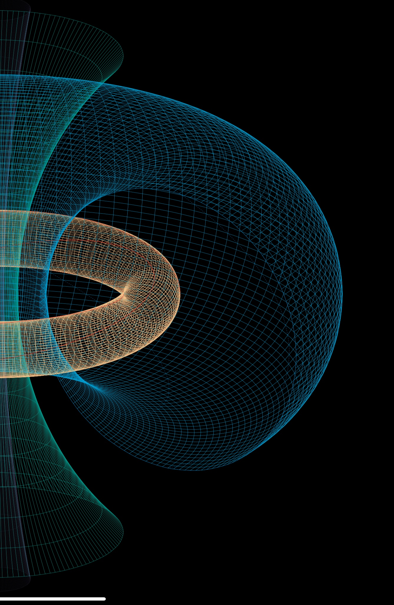

[Unlimited Blade World](https://ubw-q.github.io)  | [Background](https://ubw-q.github.io/BG)  | [Research](https://ubw-q.github.io/Rs) |  [Tex Art](https://ubw-q.github.io/Art)  
:---: | :---: | :---: | :---:
[無限劍宇](https://ubw-q.github.io/Qy) | [ 背景 ](https://ubw-q.github.io/BJ)  | [研究](https://ubw-q.github.io/Rs)       |  [ 数·图 ](https://ubw-q.github.io/Art) 

#  Qiu Yu 邱宇  
---
  

## 个人信息
**职位:**  教授 @ **清华大学** **丘成桐数学科学中心**   
**电子邮件：** [yu.qiu@bath.edu]()      
**地址:** 中国 北京 **清华大学** 双清综合楼C650

## 研究兴趣: 
代数表示论与几何拓扑。例如三角范畴（Calabi-Yau范畴、Fukaya范畴）上的稳定条件，辫子群/映射类群，模空间，丛（cluster）理论...等等。动机来自于（同调）镜像理论等。

## 编辑
[Journal of the Korean Mathematical Society](https://jkms.kms.or.kr/content/about/aimsnscope.html)

### 常用链接

* Other links:
  * [YMSC](http://ymsc.tsinghua.edu.cn/cn)
  * [Qy@YMSC](http://ymsc.tsinghua.edu.cn/cn/content/show/170-128.html)
  * [arXiv.RT](http://arxiv.org/list/math.RT/recent)
  * [arXiv.GT](http://arxiv.org/list/math.GT/recent)
  * [MathSciNet](http://www.ams.org/mathscinet/)
 
 

