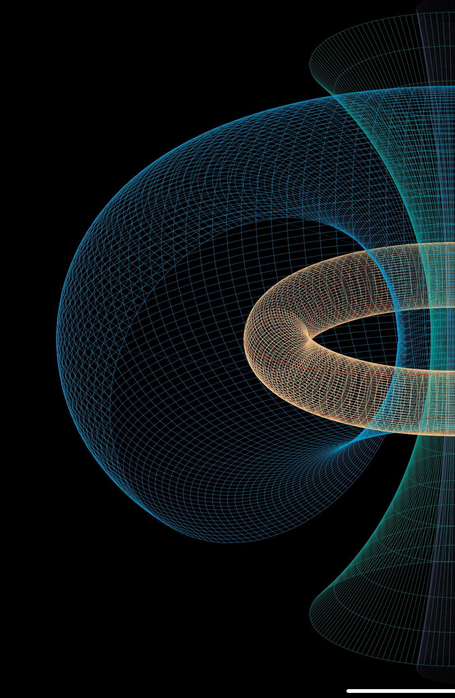
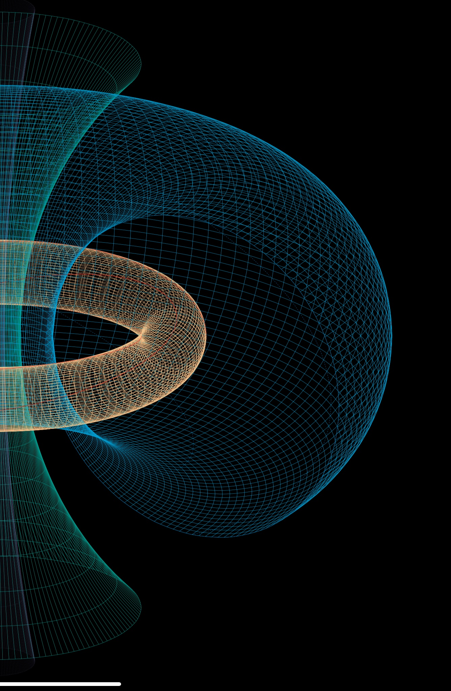

[Unlimited Blade World](https://ubw-q.github.io)  | [Background](https://ubw-q.github.io/BG)  | [Research](https://ubw-q.github.io/Rs) |  [Tex Art](https://ubw-q.github.io/Art)  
:---: | :---: | :---: | :---:
[無限劍宇](https://ubw-q.github.io/Qy) | [ 背景 ](https://ubw-q.github.io/BJ)  | [ 研究 ](https://ubw-q.github.io/Rs)       |  [ 数·图 ](https://ubw-q.github.io/Art) 

#  邱宇 Qiu Yu  
---
  

## Personal informaiton
**Position:**  [Professor](http://ymsc.tsinghua.edu.cn/cn/content/show/170-128.html) @   
**[Yau Mathematical Sciences Center](http://ymsc.tsinghua.edu.cn/cn)**, **Tsinghua University**  
**Email:** [yu.qiu@bath.edu]()    
**Address:** Shuangqing Complex Building C650   **Tsinghua University**   Beijing 100084, China   

## Research interest: 
 My research interests lie in the intersection between algebras, topology and geometry, with motivation coming from mathematical physics, e.g. (homological) mirror symmetry. In particular, I study things like quivers (with potentials), Calabi-Yau/Fukaya categories, stability conditions, braid groups, cluster theory and  moduli spaces.

* Non-asphericity of strata of genus-one differentials and stability spaces  
We show that when the number of zeros or poles is at least four, every connected component of the strata of differentials in genus one with prescribed zero and pole orders is not an orbifold K(π,1). For quadratic differentials, this provides infinitely many counterexamples to a conjecture attributed to Kontsevich, as well as to a folklore conjecture concerning the contractibility of spaces of Bridgeland stability conditions, cf. [<a href="#preprint-43">43</a>].
* X-evolution flow on cluster complexes  
We introduce flows and foliations on cluster complexes, motivated by Hatcher's flow on arc complexes (but different). It turns out to be a countinuous refinement/generalization of green mutation (on cluster exchange graphs) with application to understand the topology of cluster complexes, cf. [<a href="#preprint-41">41</a>].
* Twist groups and cluster braid groups  
We introduce the braid twist group in [<a href="#paper-7">7</a>] (cf. [<a href="#paper-14">14</a>,<a href="#preprint-42">42</a>]) and cluster braid groups in [<a href="#paper-15">15</a>] (cf. [<a href="#paper-21">21</a>]) as generalizations of Artin braid groups. In various cases, they can be identifed with spherical twist groups (of Calabi-Yau categories).
* Quadartic differentials as stability condtiions (FQuad=Stab)  
Following Bridgeland-Smith, we prove various such correspondences with various applications, cf. [<a href="#paper-15">15</a>,<a href="#paper-23">23</a>,<a href="#paper-25">25</a>,<a href="#paper-28">28</a>,<a href="#paper-30">30</a>].
* Global dimension (glidm) function  
As a byproduct of [<a href="#paper-18">18</a>,<a href="#paper-25">25</a>], we introduce gldim function (kind of piece-wise Morse) on Stab in [<a href="#paper-17">17</a>] and define the gldim for a triangulated category. See further development [<a href="#paper-19">19</a>,<a href="#paper-24">24</a>].
* q-Deformation of stability conditions  
In [<a href="#paper-18">18</a>,<a href="#paper-25">25</a>], we introduce a q-deformation of triangulated categories and the stability conditions on which. Motivation comes from the study of (almost) Frobenius structure on the spaces Stab of stability conditions, cf. [<a href="#paper-13">13</a>].  
* Geometric model for skew-gentle type categories  
Similar to DMS series, we introduce geometric models for various categories, cf. [<a href="#paper-8">8</a>,<a href="#paper-5">5</a>,<a href="#paper-32">32</a>,<a href="#paper-36">36</a>], with various realization of Z_2-symmetry.
* Decorated Marked Surfaces (DMS)  
In DMS series [<a href="#paper-7">7</a>,<a href="#paper-9">9</a>,<a href="#paper-11">11</a>,<a href="#paper-16">16</a>,<a href="#paper-14">14</a>,<a href="#paper-15">15</a>], we introduce DMS as a topological/geometric model for 3-Calabi-Yau categories associated to quivers with potential from triangulated marked surfaces (without punctures). 
* Simple tilting theory  
In [<a href="#paper-3">3</a>], we introduce the exchange graphs of (finite) hearts, which can be identified with exchange graphs of silting objets via simple-projective duality. They are skeleton of spaces of stability conditions. Moreover, we show that exchange graphs of hearts in N-Calabi-Yau categories are spherical-twist covering of the (N-1)-cluster exchange graphs. For applications, cf. [<a href="#paper-4">4</a>,<a href="#paper-6">6</a>,<a href="#paper-10">10</a>].

## Students:
李子戌 Li Zixu (2019-2024, co-sup. by Zhou Yu)  
吴东箭 Wu Dongjian (2020-2025)   
范俐 Fan Li (2021- , co-sup. by Bernhard Keller)  
卢穗麒 Lu Suiqi (2022-)   
汤立恒 Tang Liheng (2025-)  
陈思遇 Chen Siyu (2026-)  

## Postdocs: 
王起 Wang Qi (2022-2025)  
何平 He Ping (2022-2025)  
大谷拓己 Otani Kamumi (2023-2026)  
孟成 Meng Cheng (2024-2027)  
刘绵涛 Liu miantao (2026-2029)  

## Publications
### Preprints
43. Non-asphericity of strata of genus-one differentials and stability spaces, _with Dawei Chen, Jingyin Huang and Fei Yu_,  
[arxiv:2606.24135](https://arxiv.org/abs/2606.24135)

42. Decorated Marked Surfaces with vortices: Cluster braid group vs. braid twist group, _with Yu Zhou_,  
[arxiv:2511.00438](https://arxiv.org/abs/2511.00438)

41. From mutation to X-evolution: flows and foliations on cluster complexes, _with Liheng Tang_,   
[arxiv:2501.15756](https://arxiv.org/abs/arXiv:2501.15756)

40. Dg enhanced orbit categories and applications, _with Li Fan and Bernhard Keller_,  
[arxiv:2405.00093](https://arxiv.org/abs/arXiv:2405.00093)

39. A geometric realization of Koszul duality for graded gentle algebras, _with Zixu Li and Yu Zhou_,   
[aXiv:2403.15190](https://arxiv.org/abs/2403.15190)

38. Moduli spaces of quadratic differentials: Abel-Jacobi map and deformation,   
[aXiv:2403.10265](https://arxiv.org/abs/2403.10265)

37. Quadratic Differentials as Stability Conditions of Graded Skew-gentle Algebras, _with Suiqi Lu and Dongjian Wu_,   
[aXiv:2310.20709](https://arxiv.org/abs/2310.20709)

36. Two geometric models for graded skew-gentle algebras, _with Chao Zhang and Yu Zhou_,  
[arxiv:2212.10369](https://arxiv.org/abs/2212.10369)

35. Graded decorated marked surfaces: Calabi-Yau-X categories of gentle algebras, _with Akishi Ikeda and Yu Zhou_,   
[arXiv:2006.00009](https://arxiv.org/abs/2006.00009)

### Papers
1. [On the focus order of planar polynomial differential equations](https://doi.org/10.1016/j.jde.2009.02.005), _with Jiazhong Yang_,   
**J. Diff. Equations**, 246 (2009),  3361-3379. 

2. [Ext-quivers of hearts of A-type and the orientation of associahedron](https://doi.org/10.1016/j.jalgebra.2013.06.024),   
**J. Algebra**, 393 (2013),  60-70. ([arXiv:1202.6325](https://arxiv.org/abs/1202.6325))

3. [Exchange graphs and Ext quivers](https://doi.org/10.1016/j.aim.2015.08.017), _with Alastair King_,   
**Adv. Math.** 285 (2015),  1106–1154. ([arXiv:1109.2924](https://arxiv.org/abs/1109.2924))

4. [Stability conditions and quantum dilogarithm identities for Dynkin quivers](https://doi.org/10.1016/j.aim.2014.10.014),   
**Adv. Math.** 269 (2015),  220-264. ([arXiv:1111.1010](https://arxiv.org/abs/1111.1010))

5. [Tagged mapping class group: Auslander-Reiten translations](https://doi.org/10.1007/s00209-015-1405-z), _with Thomas Brüstle_,   
**Math. Zeit.** 279 (2015),  1103-1120. ([arXiv:1212.0007](https://arxiv.org/abs/1212.0007))

6. [C-sortable words as green mutation sequences](https://doi.org/10.1112/plms/pdv046),   
**Proc. Lond. Math. Soc.** 111 (2015),  1052-1070. ([arXiv:1205.0034](https://arxiv.org/abs/1205.0034))

7. [Decorated marked surfaces: Spherical twists versus braid twists](https://doi.org/10.1007/s00208-015-1339-0),   
**Math. Ann.** 365 (2016),  595-633. ([arXiv:1407.0806](https://arxiv.org/abs/1407.0806)).

8. [Cluster categories for marked surfaces: punctured case](https://doi.org/10.1112/S0010437X17007229), _with Yu Zhou_,   
**Compos. Math.** 153 (2017),  1779-1819. ([arXiv:1311.0010](https://arxiv.org/abs/1311.0010))

9. [Decorated marked surfaces (Part B): Topological realizations](https://doi.org/10.1007/s00209-017-1876-1),   
**Math. Zeit.** 288 (2018)  39–53.

10. [Contractible stability spaces and faithful braid group actions](https://projecteuclid.org/euclid.gt/1538186746), _with Jon Woolf_,  
**Geom. & Topol.** 22 (2018) 3701–3760. ([arXiv:1407.5986](https://arxiv.org/abs/1407.5986))

11. [DMS~II: Intersection numbers and dimensions of Homs](https://doi.org/10.1090/tran/7598), _with Yu Zhou_,   
**Trans. Amer. Math. Soc.** 372(2019) 635–660. ([arXiv:1411.4003](https://arxiv.org/abs/1411.4003))

12. [The braid group for a quiver with superpotential](https://doi.org/10.1007/s11425-018-9503-2),   
**Sci. China. Math.** 62 (2019) 1241–1256. ([arXiv:1712.09585](https://arxiv.org/abs/1712.09585))

13. [Stability conditions and A2 quivers](https://doi.org/10.1016/j.aim.2020.107049), _with Tom Bridgeland and Tom Sutherland_,  
**Adv. Math.** 365 (2020), 107049. ([arXiv:1406.2566](https://arxiv.org/abs/1406.2566))

14. [Finite presentations for spherical/braid twist groups](https://doi.org/10.1112/topo.12135), _with Yu Zhou_,  
**J. Topology** . 13 (2020) 501-538. ([arXiv:1703.10053](https://arxiv.org/abs/1703.10053))

15. [Cluster exchange groupoids and framed quadratic differentials](http://link.springer.com/article/10.1007/s00222-019-00932-y), _with Alastair King_,  
**Invent. Math.** 220 (2020) 479–523. ([arXiv:1805.00030](https://arxiv.org/abs/1805.00030))

16. [DMS~III: The derived category of a decorated marked surface](https://doi.org/10.1093/imrn/rnz180), _with Aslak Buan and Yu Zhou_,   
**Int. Math. Res. Notices** 2021 (2021) 12967-12992. ([arXiv:1804.00094](https://arxiv.org/abs/1804.00094))

17. [Global dimension function on stability conditions and Gepner equations](https://doi.org/10.1007/s00209-022-03170-w),  
**Math. Zeit.** 303 (2023) No.11. ([arXiv:1807.00010](https://arxiv.org/abs/1807.00010))

18. [q-Stability conditions on Calabi-Yau-X categories](https://doi.org/10.1112/S0010437X23007194), _with Akishi IKeda_,  
**Compos. Math.** 159 (2023), 1347--1386. ([arXiv:1807.00469](https://arxiv.org/abs/1807.00469))

19. [Contractibility of space of stability conditions on the projective plane via global dimension function](https://dx.doi.org/10.4310/MRL.2023.v30.n1.a3) _with Yu-Wei Fan, Chunyi Li, and Wanmin Liu_,   
**Math. Res. Letter** 30 (2023), 51–87. ([arXiv:2001.11984](https://arxiv.org/abs/2001.11984))

20. [Frobenius morphisms and stability conditions](https://doi.org/10.4171/PRIMS/60-2-1), _with Wen Chang_,  
**Publ. Res. Inst. Math. Sci.** 60 (2024), 271–303.
([arXiv:1210.0243](https://arxiv.org/abs/1210.0243))

21. [Cluster braid groups of Coxeter-Dynkin diagrams](https://doi.org/10.1016/j.jcta.2024.105935), _with Zhe Han and Ping He_,  
**J. Comb. Theory (A)**, 208 (2024), 105935.
([arXiv:2310.02871](https://arxiv.org/abs/2310.02871))

22. [Geometric model for module categories of Dynkin quivers via hearts of total stability conditions](https://doi.org/10.1016/j.jalgebra.2023.09.020), _with Wen Chang and Xiaoting Zhang_,  
**J. Algebra** 638 (2024), 57-89. ([arxiv:2208.00073](https://arxiv.org/abs/2208.00073))

23. [Quadratic differentials as stability conditions: collapsing subsurfaces](https://doi.org/10.1515/crelle-2024-0005), _with Anna Barbieri, Martin Möller and Jeonghoon So_,  
**J. reine angew. Math. (Crelle's Journal)** 810 (2024), 49-95. ([arxiv:2212.08433](https://arxiv.org/abs/2212.08433))

24. [Contractible flow of stability conditions via global dimension function](https://dx.doi.org/10.4310/jdg/1738163897).  
**J. Diff. Geom.** 129 (2025), 491-521.
([arXiv:2008.00282](https://arxiv.org/abs/2008.00282))

25. [q-Stability conditions via q-quadratic differentials](https://doi.org/10.1090/memo/1557), _with Akishi Ikeda_,   
**Memoirs of Amer. Math. Soc.** 308 (2025), No. 1557.
([arXiv:1812.00010](https://arxiv.org/abs/1812.00010))

26. [Topological model for q-deformed rational number and categorification](https://doi.org/10.4171/RMI/1525), _with Li Fan_,  
**Rev. Mat. Iberoam.**, 41 (2025), 1337–1366. ([arxiv:2306.00063](https://arxiv.org/abs/arXiv:2306.00063))

27. [Geometric classification of totally stable stability spaces](https://doi.org/10.1007/s00209-025-03678-x), _with Xiaoting Zhang_,  
**Math. Zeit.** 309 (2025) No.58.
([arxiv:2202.00092](https://arxiv.org/abs/2202.00092))

28. [Fusion-stable structures on triangulated categories](https://doi.org/10.1007/s00029-025-01037-6), _with Xiaoting Zhang_,  
**Selecta Math.** 31 (2025) No.50.
([aXiv:2310.02917](https://arxiv.org/abs/2310.02917))

29. [Perverse schobers, stability conditions and quadratic differentials II: relative graded Brauer graph algebras](https://doi.org/10.1007/s00029-026-01170-w), _with Merlin Christ and Fabian Haiden_,   
**Selecta Math.**, 32 (2026) No.62.
([arxiv:2407.00154](https://arxiv.org/abs/arXiv:2407.00154))

30. Verdier quotients of Calabi-Yau categories from quivers with potential,  _with Anna Barbieri_,  
**Doc. Math.**, to appear.
([arxiv:2411.00207](https://arxiv.org/abs/arXiv:2411.00207))

31. Perverse schobers, stability conditions and quadratic differentials I, _with Merlin Christ and Fabian Haiden_,   
**Compos. Math.**, to appear.
([arxiv:2303.18249](https://arxiv.org/abs/arXiv:2303.18249))

32. Contractibility and total semi-stability conditions of Euclidean quivers, _with Xiaoting Zhang_,   
**Math. Proc. Camb. Phil. Soc.**, to appear.
[arxiv:2501.16903](https://arxiv.org/abs/arXiv:2501.16903)

### Proceedings
33. Topological structure of spaces of stability conditions and top. Fukaya type categories,  
_Proceedings of the **International Consortium of Chinese Mathematicians**_ (2017) 521–538, Int. Press, Boston, MA, 2020. ([arXiv:1806.00010](https://arxiv.org/abs/1806.00010))

34. Decorated Marked Surfaces: Calabi-Yau categories and related topics,   
_Proceeding of the **51st Symposium on Ring Theory and Rep. Theory**_, 129–134, _Symp. Ring Theory Represent. Theory Organ. Comm._, Shizuoka, 2019. ([arXiv:1812.00008](https://arxiv.org/abs/1812.00008))

## Editoral Board
[Journal of the Korean Mathematical Society](https://jkms.kms.or.kr/content/about/aimsnscope.html)

### Useful Links

* Other links:
  * [YMSC](http://ymsc.tsinghua.edu.cn/cn)
  * [arXiv.RT](http://arxiv.org/list/math.RT/recent) // [GT](http://arxiv.org/list/math.GT/recent) // [AG](http://arxiv.org/list/math.AG/recent) 
  * [MathSciNet](http://www.ams.org/mathscinet/)
